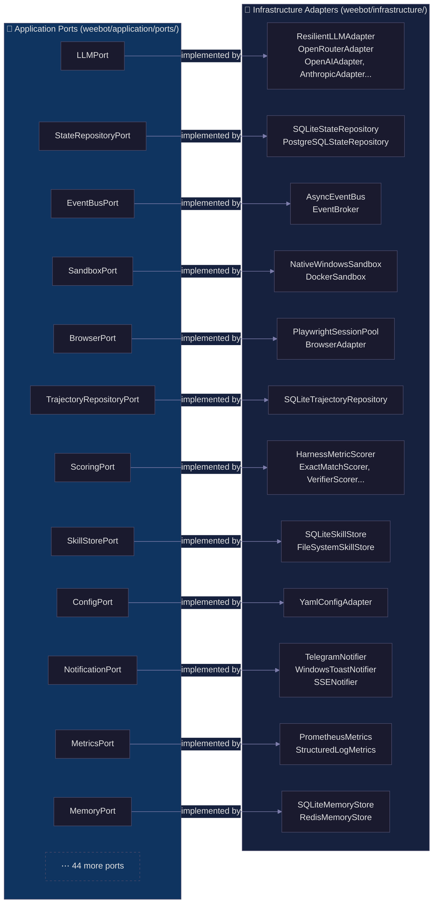

# ARCHITECTURE.md — weebot AI Orchestrator

**Last updated:** 2026-07-07 (Architecture 9 Plan — Phase 1–2, 11/15 steps)
**Architecture score:** see the audit records, `tasks/specs/arch_audit_2026_10_wave2_remediation_plan.md` (EGFV static audit of 2026-10-25: 7/10) and `tasks/specs/arch_audit_2026_10_remediation_plan.md` (2026-10-24: 4/10 before that wave). The 9.0 once printed here was a hand-typed self-score and had gone stale.
**Last audit:** 2026-10-24 EGFV static audit, remediation plan above. Earlier: _archive/root-2026-10-23/reports/implementation_audit_report.md (2026-07-07)
**Maturity:** Early production. "Production" returns when the Sep plan's Phase 5.5 (replica proof) passes; the app is single-replica until then.
**Paradigm:** Clean Architecture (Hexagonal Ports & Adapters) + CQRS Mediator + State-Machine Flows

---

## Recent Changes (2026-06-07)

## Architecture Remediation Update (2026-06-18)

**Audit score:** not stated here. This section is a 2026-06-18 record of what changed,
and it used to carry "6/10 → Estimated: 7.5-8.0/10 (post-remediation)" — an estimate for
that date that the header's own measurement contradicts (the 2026-10-24 audit scored the
*later* code 4/10, and the 2026-10-25 audit after the wave-2 plan scored it 7/10). Scores
live in the audit records: `tasks/specs/arch_audit_2026_10_remediation_plan.md` and
`tasks/specs/arch_audit_2026_10_wave2_remediation_plan.md` (WB-05).
**Remediation plan:** ARCHITECTURE_REMEDIATION_PLAN.md
**ExecutorAgent:** 1,414 lines → 803 lines (−43%), 4 collaborators extracted

### Completed Changes

| Change | Files |
|--------|-------|
| ExecutorAgent extraction | `_cascade.py`, `_tool_executor.py`, `_context_compressor.py`, `_error_handler.py` |
| Port creation (SkillStorePort, TrajectoryRepositoryPort) | `ports/skill_store_port.py`, `ports/trajectory_repository_port.py` |
| Application→infrastructure leakage fix | 6 handlers/flows updated; `transfer_handler.py` DI-injected |
| Core layer boundary fix | `scan_for_injection` → `infrastructure/security/` |
| Mutable state fixes | `_TOOL_TIERS` accessors, `reset_all_buckets()`, `_reset_metrics_cache()` |
| Metrics bridge | `services/metrics_bridge.py`; 3 callers updated |
| CQRS handler split | `handlers.py` (779→321 lines) → 8 individual handler files |
| Deprecated port deletion | `capability_gate_port.py`, `truth_binding_port.py` |

### New Architecture Decision Records

**ADR-006:** Port Rationalization (2026-06-18) — Delete ports with <2 implementations and no planned polymorphism. 2 deprecated ports deleted. 27 single-impl ports retained as they have callers.

**ADR-007:** ExecutorAgent Extraction (2026-06-18) — Split 1,414-line god class into 5 focused units: orchestrator (`_base.py`, ~800 lines), cascade executor (295 lines), tool executor (198 lines), context compressor (149 lines), error handler (129 lines).
> **Amendment 2026-10-24 (DOC-3).** The sizes above were true on 2026-06-18 and are not now: `_base.py` grew past them (`lint_long_functions.py --list` shows `ExecutorAgent.execute_step` among the over-150-line functions). The target is no longer prose. It is the `functions_over_150_lines` ratchet in `tasks/quality/ceilings.toml`, which only moves down when a god method is split.

> **Amendment 2026-10-24 (DOC-2, decision D4).** `TaskQueuePort` was NOT deleted and is kept on purpose, reserved for the Sep plan's Phase 5.2 (scheduler extraction and multi-process work dispatch). Both adapters (`infrastructure/queue/in_memory_task_queue.py`, `redis_task_queue.py`) stay under a shared contract test so they do not rot while unused.

**ADR-008:** Port Rationalization v2 (2026-06-18) — ToolDiscoveryPort and TaskQueuePort deleted (zero non-TYPE_CHECKING runtime callers). Plan's original estimate of "39 deletable ports" corrected to 2 — remaining 30 single-impl ports all have DI registrations or runtime consumers and are retained with planned-polymorphism documentation.

**ADR-009:** FlowRouter Extraction (2026-06-18) — State-transition routing logic extracted from PlanActFlow.run() into FlowRouter.resolve_initial_state(). Routing decisions now testable in isolation. Session context mutations (flag clearing, misalignment recording) preserved via tuple return (FlowState, Session).

### v2 Completed Changes (2026-06-18)

| Change | Files | Impact |
|--------|-------|--------|
| FlowRouter extraction | `flows/flow_router.py`, `flows/plan_act_flow.py` | State routing testable in isolation |
| `query_handlers.py` split | 3 files (session/plan/active) | 445→avg 150 lines per file |
| `_handle_step_completion` extraction | `agents/executor/_base.py` | execute_step reduced ~40 lines |
| `reset_global_pool()` added | `infrastructure/browser/session_pool.py` | Test isolation for browser pool |
| Port cleanup v2 | `ToolDiscoveryPort`, `TaskQueuePort` deleted | 2 unused ABCs removed |
| Cascade integration tests | `tests/integration/test_cascade_integration.py` | 8 tests, env-var gated |
| Architecture fitness tests | `test_architecture_fitness.py` | 5 new tests (39 total) |

### Remaining Debt

| # | Item | Severity | Status |
|---|------|----------|--------|
| D1 | Root-level stray files | — | CLOSED 2026-10-30: none of the four is left at the `weebot/` root; `tests/unit/interfaces/test_tray.py`, which always skipped, was deleted |
| D2 | Core framework coupling — `agent.py` LangChain deps | — | CLOSED 2026-10-24: `core/agent.py` deleted (plan 3.5, decision D3) |
| D3 | `.importlinter` ignore_imports | LOW | Count and target live in `import_exemptions` in `tasks/quality/ceilings.toml` (`scripts/lint_import_exemptions.py`); this table states no number |
| D4 | `plan_act_flow.py` over its 700-line target | — | CLOSED 2026-10-30: 654 lines. The once-per-run prologue of `_run_states` (run span, original task, side constraints, rule hydration, tool scoping, initial-state routing) moved to `flows/_run_prologue.py` as `begin_run`; the tool-result handling had already moved out |
| D5 | `_base.py` over its 650-line target | — | CLOSED 2026-10-30: 647 lines. The preamble was already in `_step_setup.py`; the system-prompt loader moved to `_system_prompt.py` (one loader, shared with `_tool_executor.py`), and the skill-gap recorder to `_step_setup.py`, which calls it again |
| D6 | `behavior_tracker.py` git ops in core layer | LOW | Extracted to async helper; needs migration to infrastructure/persistence (P4) |

---

## Architecture Diagram

> Generated 2026-06-30. Mermaid live-editor compatible.

### Layer Boundaries & Dependency Direction

Dependencies flow **inward**: each outer layer depends on the layer(s) it wraps, never outward. Domain is pure — zero imports from any other layer. Infrastructure implements ports defined by Application/Domain; Interfaces wire everything via the DI container.

```mermaid
%%{init: {'theme':'base','themeVariables': {
  'primaryColor': '#1a1a2e',
  'primaryTextColor': '#e0e0e0',
  'primaryBorderColor': '#4a4a6a',
  'lineColor': '#7c7caa',
  'secondaryColor': '#16213e',
  'tertiaryColor': '#0f3460'
}}}%%
graph TD
    subgraph interfaces["🔌 Interfaces — Entry Points"]
        direction LR
        CLI["<b>CLI</b><br/>click commands<br/>harness / flow / dream"]
        WEB["<b>Web API</b><br/>FastAPI / WebSocket / SSE<br/>routers / middleware"]
        GATEWAYS["<b>Gateways</b><br/>Discord / Slack / Telegram"]
        UI["<b>Next.js UI</b><br/><i>weebot-ui/</i>"]
    end

    subgraph tools["🛠️ Tools — Agent Tool Layer"]
        direction LR
        TOOL_BROWSER["<b>BrowserTool</b><br/>browser-use + Playwright"]
        TOOL_BASH["<b>BashTool</b><br/>sandboxed shell exec"]
        TOOL_PYTHON["<b>PythonTool</b><br/>sandboxed code runner"]
        TOOL_FILE["<b>FileEditorTool</b><br/>read / write / patch"]
        TOOL_OTHER["39+ tools<br/>image gen, mail,<br/>voice, scheduling..."]
    end

    subgraph app["🧠 Application — Orchestration"]
        direction LR
        FLOWS["<b>Flows</b><br/>PlanActFlow • ChatFlow<br/>HarnessOptFlow • SkillOptFlow"]
        AGENTS["<b>Agents</b><br/>Planner • Executor • Critic<br/>Dreamer • Retention"]
        CQRS["<b>CQRS</b><br/>Mediator • Commands<br/>Queries • Handlers"]
        DI["<b>DI Container</b><br/>Container + mixins"]
        SERVICES["<b>Services</b><br/>Task Runner • Model Selection<br/>Harness • Scoring • Regression"]
    end

    subgraph infra["🏗️ Infrastructure — Adapters"]
        direction LR
        LLM["<b>LLM Adapters</b><br/>OpenRouter • OpenAI • Anthropic<br/>DeepSeek • Moonshot • Resilient"]
        PERSIST["<b>Persistence</b><br/>SQLite • PostgreSQL<br/>Event Store • Trajectory Repo"]
        BROWSER["<b>Browser</b><br/>Playwright Pool"]
        SANDBOX["<b>Sandbox</b><br/>Native • Docker"]
        OBSERV["<b>Observability</b><br/>StructLog • Prometheus<br/>Metrics • Tracing • Health"]
        MCP["<b>MCP</b><br/>Client Bridge • Toolkit"]
    end

    subgraph domain["🎯 Domain — Pure Entities"]
        direction LR
        MODELS["<b>Models</b><br/>Session • Plan • Event<br/>CodeReview • Step • ToolCall"]
        PORTS["<b>Protocol Ports</b><br/>IModelProvider • IRepository<br/>ITool • EventPublisher"]
        SERVICES_DOM["<b>Services</b><br/>Session Memory • Working Memory<br/>Human Interaction"]
    end

    subgraph core["⚙️ Core — Cross-Cutting"]
        direction LR
        BASH_GUARD["Bash Guard<br/>(security sandbox)"]
        CASCADE["Model Cascade<br/>(model routing)"]
        SAFETY["Safety<br/>(egress / circuit breaker)"]
        LOGGING["Structured Logger<br/>(trace / correlation ID)"]
    end

    interfaces -->|"depends on"| app
    interfaces -->|"composition root"| infra
    app -->|"depends on"| domain
    infra -->|"implements ports"| app
    infra -->|"implements ports"| domain
    tools -->|"depends on ports, wired by DI"| app
    tools -->|"BaseTool, ToolResult"| domain
    tools -->|"uses"| core
    app -->|"uses"| core
    core -.->|"(no inward deps)"| domain

    style interfaces fill:#1a1a2e,stroke:#4a4a6a,color:#e0e0e0
    style tools fill:#16213e,stroke:#4a4a6a,color:#e0e0e0
    style app fill:#0f3460,stroke:#4a4a6a,color:#e0e0e0
    style infra fill:#0f3460,stroke:#4a4a6a,color:#e0e0e0
    style domain fill:#1a3a2e,stroke:#4a6a4a,color:#e0e0e0
    style core fill:#3a2a1a,stroke:#6a5a3a,color:#e0e0e0
```

### Port / Adapter Mapping

**56+ ports** are defined in `weebot/application/ports/`. Key mappings below show which adapter(s) implement each port:

### Session persistence during a run

The flow's `EventPublisher` owns session persistence: it saves after every event it emits. When a flow has its own state repo and session, `TaskRunner` does not save per event; it writes once, at the end, from the flow's copy plus the events and title only the runner saw. A job that works from an old copy of a RUNNING session (memory compaction) writes with `save_session_if_unchanged`, which refuses when the row's `updated_at` has moved. Two whole-session writers from two copies lose each other's events (audit A24, A25).

### Network off in the native sandboxes

With `allow_network` off, `NativeWindowsSandbox` only points the proxy variables at a dead port (`infrastructure/sandbox/native_windows.py`, `_build_child_env`), and the WSL2 sandbox does nothing. A tool that ignores proxies, or opens a raw socket, still reaches the network. It stays advisory unless the owner decides otherwise (master plan D9 recommends keeping it so): enforcing it would take a per-process firewall rule. The sandbox factory logs this once per sandbox type (`_warn_if_network_off_is_best_effort`). For real isolation use `SANDBOX_MODE=docker` (audit A22).

### How weebot learns

Each loop below carries something from one run into later ones. All of them are on by default, and each has a `WEEBOT_*` flag in `weebot/config/feature_flags.py` that turns it off.

- **Lessons.** After a run, `MetaAnalysisState` writes one lesson to the per-project misalignment journal. Planning reads the recent ones back.
- **Skills.**
  - A run whose every step completed is distilled into a quarantined skill. An existing skill of that name is never overwritten.
  - The review gate promotes it to candidate.
  - Candidates are injected live, at most one per step, and each step reports the candidates it used (`RecordSkillUseCommand`).
  - Three successful sessions promote a candidate to trusted. Two failed sessions send it back to quarantined.
  - Every tier change is written to `.weebot/skills/<name>/SKILL.md`, so the retriever sees it.
  - Curation moves learned skills that have gone unused for months to `.weebot/skills/_archived/`.
- **Plans.** A plan whose every step completed is stored as a template, one per task. The planner sees matching templates as notes.
- **Workflows.** Agent Workflow Memory generalizes a finished plan into abstract steps, stored in `workflow_templates`. The first planner of a similar task gets them as hints.
- **Failures.** A failed run's trajectory keeps its task and gets a failure signature. Planning adds the two most similar past failures as notes.
- **Models.** One shared `AdaptiveCapabilityRouter` records each model call's outcome per step category in `acr_posteriors.db`. Those posteriors move its ranking; it adds at most two models to the cascade.
- **Corrections.** User corrections become behavioral rules in later prompts.

Opt-in loops (D4, each off until its flag is set):

- **Step progress** (`WEEBOT_STEP_EVALUATOR`): a verifier-model call scores each step; a step that does not advance the plan is replanned and counts as a failed use of its candidate skills.
- **Promotion veto** (`WEEBOT_SKILL_PROMOTION_GATE`): before a candidate becomes trusted, chain of verification checks its claims; contradicted claims keep it a candidate.
- **Episodic summaries** (`WEEBOT_EPISODIC_SUMMARIES`): a successful run leaves a summary; planning a similar task gets "a similar past task succeeded" notes.
- **Strategies** (`WEEBOT_STRATEGY_TRANSFER`): a successful run's approach is offered when planning a different kind of task.
- **Checkpoints** (`WEEBOT_FLOW_CHECKPOINTS`): the plan is saved after each step; `flow recover ID` resumes an interrupted run.
- **Model benchmarks**: `benchmark model ID` measures a model and merges the result, axis by axis, into the profile the router reads.
- **Config edits** (`WEEBOT_SELF_EDIT_CONFIG`): `improve propose FILE` asks a model to revise a rule or contract file from recent failures; nothing changes until a human runs `improve apply ID`.

Not automatic: `SkillOptFlow` and `HarnessOptFlow` (manual commands; `harness evolve --quality-signal`, `harness baseline --judge`, `skill compare`), the `self_harness_weekly` job (it needs held-in and held-out task sets), and self-editing of the improver itself (`WEEBOT_METACOGNITIVE_IMPROVEMENT`, off).

### Architecture Enforcement

Architecture boundaries are enforced at three levels:

| Level | Mechanism | What It Checks |
|-------|-----------|----------------|
| **Static (CI)** | `.importlinter` contracts (`lint-imports` lists them) | Layer boundaries: domain purity, tools-no-db, infra-no-app-services, interfaces-no-infra and more |
| **Dynamic (CI)** | `tests/unit/test_architecture_fitness.py` | AST-based: layer boundaries, port contracts, import rules |
| **Lint (CI)** | `scripts/lint_async_io.py` | Blocking I/O inside async def (open(), sqlite3.connect(), etc.) |
| **Lint (CI)** | Ruff `B` rules (bugbear) | Mutable defaults, bare except, etc. |

See `.importlinter` (contracts) and `tests/unit/test_architecture_fitness.py` for the full dependency matrix.
